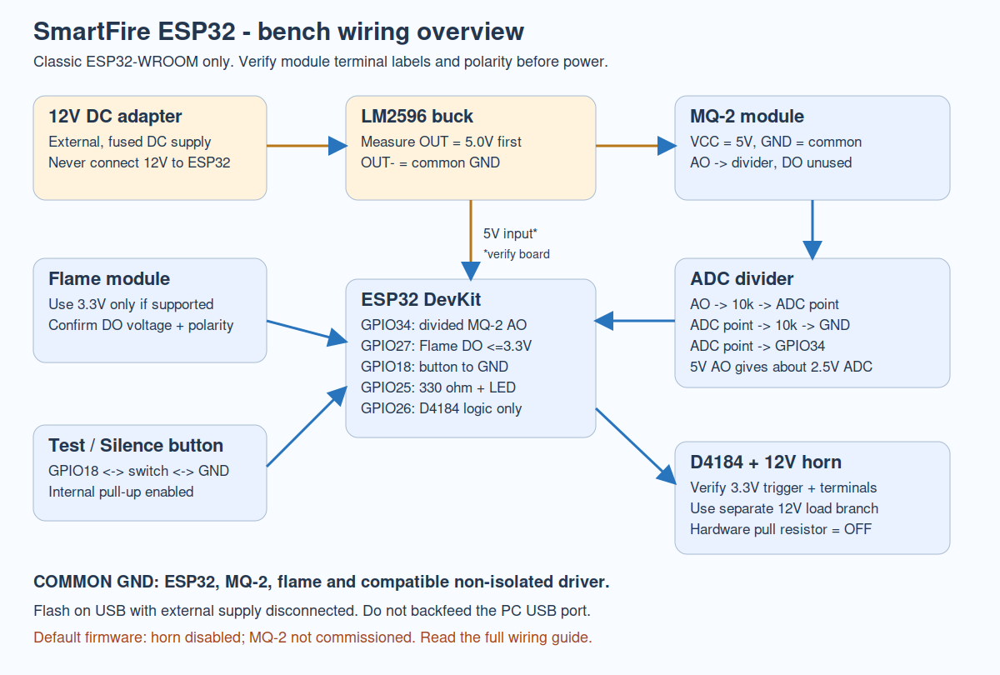

# SmartFire ESP32 — firmware nền v0.1.0

**Embedded firmware runs directly on the ESP32 and keeps working without an app.**  
Firmware nhúng là chương trình được biên dịch cho vi điều khiển, nạp vào flash của ESP32 và tự chạy khi cấp điện. Máy tính chỉ cần để build/flash/debug; sau đó thiết bị chạy độc lập.

Bộ này dành cho **prototype STEM/KHKT THPT**, dự kiến dùng ESP32-WROOM DevKit CH340 Type-C 30 chân đã mô tả. CH340 là USB-to-UART, không phải tên chip ESP32. Kiểm tra chữ trên module kim loại; cấu hình này không dành cho ESP32-C3/S3/C6. Chưa thể xác nhận pinout chính xác chỉ từ tên đơn hàng.

## Có gì trong phiên bản này?

| Chức năng | Hiện có |
|---|---|
| Đọc MQ-2 AO qua ADC1 GPIO34 | Có; lấy trung bình 8 lần, mỗi 50 ms |
| Đọc Flame DO GPIO27 | Có; xác nhận tín hiệu liên tục 500 ms |
| Phát hiện bằng luật cục bộ | Có; hysteresis (hai ngưỡng bật/tắt), thời gian xác nhận, thời gian phục hồi |
| Còi 12V qua D4184 | Có mã điều khiển GPIO26; mặc định interlock vô hiệu đầu ra để thử bàn |
| Nút rời | Có; nhấn ngắn Silence, giữ 2 giây Test; không ngắt toàn bộ hệ thống |
| Wi-Fi và API LAN | Có; trạng thái, sự kiện, ACK/Silence/Test có token |
| Định danh nhiều node | Có `device_id`, `room_id`, `boot_id`, `seq`; đổi cấu hình cho từng node |
| Mất Wi-Fi vẫn báo tại chỗ | Kiến trúc tách task mạng; cần kiểm thử trên board thật |
| Lịch sử trên ESP32 | Ring buffer RAM 32 sự kiện; mất khi khởi động lại |
| App SQLite, map 2D, QR vị trí, bình chữa cháy | Contract đã có; chưa viết app trong bộ firmware này |
| Push notification khi app đóng / qua Internet | Chưa có; API LAN không thay cho push notification |
| Đồng bộ còi tất cả node, AI, nguồn dự phòng | Chưa triển khai; có hướng mở rộng trong docs |

**Không có ngưỡng MQ-2 nào trong bộ này đã được kiểm chứng cho phát hiện cháy.** `2400/1900` là số đếm ADC minh họa, không phải ppm. Không tự học baseline mỗi lần boot vì môi trường nguy hiểm lúc boot có thể bị học thành “bình thường”. MQ-2 không phân biệt chắc chắn khói cháy với khí/hơi gây nhiễu.

## Đọc theo thứ tự

1. [Đấu dây và kiểm tra điện áp](docs/01_WIRING_VI.md).
2. [Cài công cụ, build, nạp, cấu hình và thử bàn](docs/02_FLASH_AND_COMMISSION_VI.md).
3. [Architecture và hướng phát triển](docs/03_ARCHITECTURE_VI.md).
4. [API cho app và SQLite](docs/04_API_VI.md).
5. [Kế hoạch kiểm thử và trạng thái xác minh](docs/05_VERIFICATION_VI.md).



## Các file bạn sẽ sửa

- `include/Config.h`: GPIO, cực kích, bật còi, ngưỡng MQ-2 và xác nhận commissioning.
- `include/Secrets.h`: tự tạo từ `Secrets.example.h`; Wi-Fi, token, tên node, phòng.
- `lib/AlarmCore/AlarmCore.h`: các quy tắc phát hiện và điều khiển trạng thái, không phụ thuộc Arduino.
- `include/Hardware.h`: ADC, nút, LED, GPIO.
- `src/Transport.cpp`: Wi-Fi và HTTP, tách khỏi vòng điều khiển.
- `src/main.cpp`: orchestration (điều phối), sample → policy → output → event.

Không cần sửa toàn bộ chương trình để thay Wi-Fi hoặc GPIO. Cấu hình được compile vào firmware ở v0.1; chưa có provisioning (cấu hình lần đầu bằng app), NVS hay OTA.

Có sẵn binary thử bàn trong `prebuilt/`; xem `prebuilt/README.md`. Muốn bật Wi-Fi/đặt ngưỡng riêng, cần sửa cấu hình và build lại source.

## Bắt đầu nhanh

1. Cài VS Code + PlatformIO IDE.
2. Giải nén, Open Folder đúng thư mục có `platformio.ini`.
3. Copy `include/Secrets.example.h` thành `include/Secrets.h`; ban đầu có thể để trống Wi-Fi/token, Serial và logic cục bộ vẫn chạy.
4. Để `kHornEnabled=false` và `kGasCommissioned=false`; chỉ nối USB PC với ESP32 để nạp lần đầu.
5. PlatformIO: **Build → Upload → Monitor**, baud `115200`.
6. Khi chạy, Serial in `WARMING`; sau 180 giây chuyển `UNCONFIGURED` nếu không có tín hiệu/lỗi khác. Chưa có MQ-2, ADC thấp có thể báo `FAULT`; đó là diagnostic dự kiến, không phải đã lắp đúng.
7. Đấu cảm biến theo hướng dẫn, đo điện áp, điều kiện hóa MQ-2 và thực nghiệm ngưỡng; sau đó mới bật các cờ commissioning.

CLI tương đương trong PlatformIO Terminal:

```sh
pio run -e esp32dev
pio run -e esp32dev -t upload
pio device monitor -b 115200
```

Nếu không cài extension, có thể dùng `python -m pip install platformio`, rồi `python -m platformio run` thay `pio run`.

## Giới hạn sử dụng

Đây là firmware nghiên cứu chưa chứng nhận PCCC, chưa được flash/lắp thử trên phần cứng của bạn. Thử bằng tín hiệu điện an toàn và LED trước. Không dùng làm hệ thống bảo vệ cháy duy nhất. Bản build dùng toolchain khóa phiên bản để tái lập kết quả; đó không phải cam kết đây là phiên bản framework mới nhất hoặc đủ điều kiện triển khai sản phẩm thương mại.
