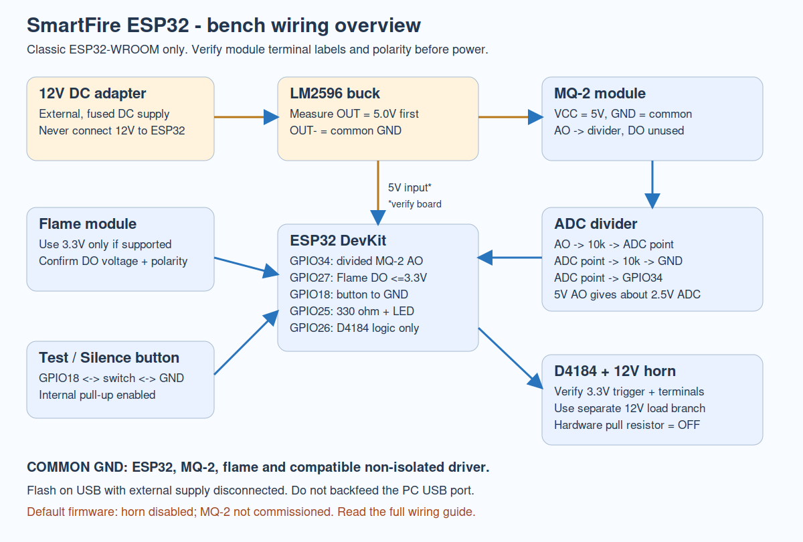

# Đấu dây — làm khi toàn bộ nguồn đã tắt

**GPIO numbers identify signals, not positions on the header.**  
GPIO34 là nhãn tín hiệu trên board, không phải chân thứ 34. Đọc chữ in trên đúng board, không dựa vào vị trí của ảnh board khác.

## 1. Phần cứng đang giả định

ESP32-WROOM DevKit 30 chân, MQ-2 module có VCC/GND/AO/DO, flame module có DO, LM2596, module MOSFET D4184, còi/đèn 12V, adapter 12V DC. Các model chính xác và cực kích của flame/D4184 chưa được xác nhận bằng ảnh cận cảnh hoặc đo thực tế. Sơ đồ dưới là thiết kế chức năng; tên terminal D4184 phải đối chiếu đúng module trước khi đấu.

Cần có đồng hồ vạn năng, 2 điện trở 10kΩ (nên 1%), LED + trở 330Ω, đầu nối chắc chắn; tụ 100nF ở ADC có thể bổ sung. Mạch chia áp trước đây 10k/15k lý thuyết cho 3V từ 5V; bản này dùng **10k/10k** để thêm biên độ dự phòng và dễ kiểm tra, nên phải hiệu chỉnh ngưỡng với chính mạch chia áp này.

## 2. Bảng nối GPIO

| Đi từ | Đi đến | Điều kiện |
|---|---|---|
| MQ-2 VCC | LM2596 OUT+ đo đúng 5,0V | MQ-2 cần heater; không lấy nguồn từ 3V3 |
| MQ-2 GND | GND chung | Nối chắc |
| MQ-2 AO | Điện trở R1 10kΩ | Không nối thẳng ADC |
| Đầu còn lại R1 | GPIO34 và đầu R2 10kΩ | Đây là điểm giữa chia áp |
| Đầu còn lại R2 | GND | Cần nối cả khi cảm biến chưa cắm |
| MQ-2 DO | Để trống | Firmware không sử dụng |
| Flame VCC | 3V3 **chỉ nếu đúng module hỗ trợ 3,3V** | Nếu bắt buộc 5V, cần chuyển mức DO trước khi nối ESP32 |
| Flame GND | GND chung | — |
| Flame DO | GPIO27 | Đo mức HIGH; tối đa 3,3V theo thiết kế |
| Flame AO | Để trống | — |
| GPIO26 | D4184 signal/TRIG đúng sơ đồ module | Chỉ nối sau khi xác nhận 3,3V kích được, cực active và mass |
| D4184 logic GND | ESP32 GND | Với module kích dùng mass chung; không giả định module có cách ly |
| GPIO18 | Một phía tiếp điểm nút | Code `INPUT_PULLUP` |
| Phía còn lại nút | GND | Nhấn = LOW; nút 4 chân kiểm tra continuity để chọn hai nhóm tiếp điểm |
| GPIO25 | Trở 330Ω → anode LED | Cathode LED → GND |
| GPIO21 / GPIO22 | Chưa nối | Dự phòng I²C cho cảm biến nhiệt sau này |

Chia áp: **MQ AO → R1 10k → điểm ADC → R2 10k → GND**. Tụ 100nF tùy chọn từ điểm ADC xuống GND. Công thức `V_ADC = V_AO × R2/(R1+R2)`, nên 5V vào cho khoảng 2,5V ra. Đo xác nhận ở cả điểm AO và ADC. Chia áp chỉ giảm biên độ, không phải bảo vệ quá áp tuyệt đối; không nối nhầm AO sang 12V.

Không gọi `gas_raw` là ppm; ADC chưa tuyến tính lý tưởng, sensor chưa được hiệu chuẩn khí chuẩn. Tổng trở chia áp cũng tải đầu ra AO, vì vậy phải đo/đặt ngưỡng trên cấu hình đã lắp hoàn chỉnh.

## 3. Cấp nguồn

| Nhánh | Kết nối |
|---|---|
| Adapter 12V+ | Qua cầu chì DC chọn theo dòng thực tế/dây → nhánh còi và LM2596 IN+ |
| Adapter 12V− | LM2596 IN− và mass mạch công suất theo đúng module |
| LM2596 OUT+ | Chỉnh và đo 5,0V trước → MQ-2 VCC và đầu vào 5V phù hợp của DevKit |
| LM2596 OUT− | ESP32 GND, MQ-2 GND, Flame GND và mass kích D4184 nếu module yêu cầu |
| Còi 12V | Dùng nhánh công suất D4184, không đi qua chân ESP32 |

Phân biệt **adapter 12V-5A** là khả năng cấp tối đa 5A, không phải luôn đẩy 5A vào mạch. Chọn cầu chì theo tải thực tế và tiết diện dây; chưa có dòng còi nên chưa chốt trị số cầu chì. Còi tải lớn dùng dây/terminal riêng, không kéo dòng qua breadboard.

Đường công suất nếu module thực tế đúng là **low-side switch**: nguồn 12V+ → còi (+), còi (−) → ngõ ra MOSFET kéo xuống mass. Nhưng một số module có terminal V+/V−/OUT+/OUT− hoặc nguồn kích riêng: **không ánh xạ tên terminal theo phỏng đoán**. Đọc sơ đồ/đo đúng module, không nối GPIO26 vào terminal công suất. Nếu chưa xác định được terminal hoặc mức kích, dừng ở thử LED, để còi chưa nối.

Giữ gate/input ở mức OFF lúc boot bằng điện trở kéo phù hợp (thường pull-down 10k cho active-high nếu module chưa có; active-low cần pull-up đúng mức logic). Code chỉ kiểm soát được sau khi MCU khởi động, không ngăn được gate trôi trước đó. Không kéo input ESP32 lên 5V/12V. Nếu tải có tính cảm và module/tải chưa có bảo vệ xung, chọn bảo vệ phù hợp đúng loại tải trước khi đấu.

**Hai chế độ cấp nguồn ESP32:**

- Khi nạp qua USB PC: ngắt adapter ngoài và nhánh 5V ngoài vào board. Để ESP32 lấy nguồn USB.
- Khi chạy độc lập: rút USB PC, dùng 5V đã đo từ buck qua đường 5V/USB phù hợp đúng board. Chỉ dùng chân `5V/VIN` sau khi xác nhận sơ đồ board; tên VIN không chứng minh được phép cấp 12V.

Không đồng thời cấp USB PC và nguồn 5V ngoài nếu chưa xác nhận board có power-path chống backfeed. Adapter ở ngoài vỏ; không đưa điện lưới vào prototype.

## 4. Trước khi nối ESP32

1. Rút ESP32, MQ-2, còi khỏi nguồn. Đấu adapter → buck; chỉnh OUT=5,0V bằng đồng hồ.
2. Tắt điện; đấu MQ-2 và chia áp. Cấp điện lại, đo tại điểm giữa chia áp; thiết kế mục tiêu khoảng 0–2,5V với AO 0–5V.
3. Kiểm tra flame module: nguồn cho phép, mức DO và active-low/active-high. Nếu không hỗ trợ 3,3V, dùng level shifting phù hợp.
4. Tắt điện; nối GND và tín hiệu vào ESP32. Thử Serial + LED với `kHornEnabled=false`.
5. Sau cùng mới xác nhận D4184 và còi; thử Test có kiểm soát rồi thử trạng thái boot/reset. Không giả định nghe còi một lần là đã chứng minh cả chuỗi phát hiện hoạt động.

MQ-2 có bộ gia nhiệt nóng: chừa thông khí, giữ xa cảm biến nhiệt, dây và nhựa dễ mềm. Không bịt kín cảm biến trong vỏ. Chỉ thi công phần DC, không sửa adapter điện lưới.

## 5. Tài liệu gốc

- Espressif ADC API: https://docs.espressif.com/projects/arduino-esp32/en/latest/api/adc.html
- ESP32 datasheet: https://documentation.espressif.com/esp32_datasheet_en.html
- Winsen MQ-2: https://www.winsen-sensor.com/sensors/combustible-sensor/mq2.html

Winsen yêu cầu điều kiện hóa/preheat ít nhất 48 giờ trong điều kiện thử tiêu chuẩn. Mốc warm-up 180 giây trong code chỉ là thời gian inhibit sau boot phục vụ phát triển, không thay thế điều kiện hóa ban đầu và không chứng minh sensor đã ổn định trong môi trường cụ thể.
