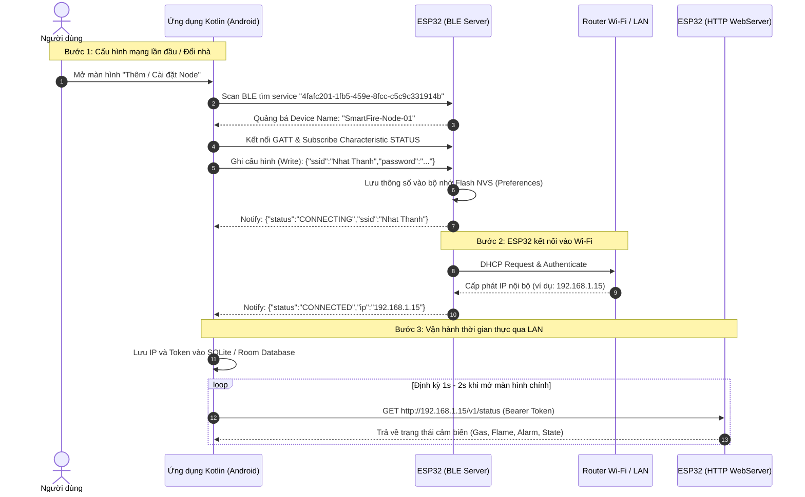

# Kiến trúc Đồng bộ & Cấu hình BLE (BLE Provisioning & Sync Architecture)

Tài liệu này chuẩn hóa toàn bộ giao thức kết nối, cấu hình mạng và đồng bộ dữ liệu giữa **Ứng dụng di động (Android / Kotlin)** và **Node vi điều khiển ESP32 SmartFire**.

---

## 1. Tổng quan mô hình 2 kênh truyền thông

Hệ thống sử dụng mô hình kết hợp **Hybrid (BLE + LAN Wi-Fi)**:



---

## 2. Đặc tả kỹ thuật kênh BLE Provisioning

ESP32 khởi chạy BLE Server ngay khi cấp nguồn và duy trì quảng bá (Advertising).

### 2.1. Định danh BLE
* **Tên thiết bị (Device Name)**: `SmartFire-Node-01`
* **Service UUID**: `4fafc201-1fb5-459e-8fcc-c5c9c331914b`

### 2.2. Danh sách Characteristic

| Tên | UUID | Thuộc tính | Định dạng Payload | Chức năng |
|---|---|---|---|---|
| **`CONFIG`** | `beb5483e-36e1-4688-b7f5-ea07361b26a8` | **Write** | JSON String | App gửi SSID và Mật khẩu Wi-Fi sang ESP32. |
| **`STATUS`** | `1c95d5e3-d8f7-413a-bf3d-7a2e5d7be87e` | **Read / Notify** | JSON String | ESP32 phát trạng thái kết nối và IP về App. |

#### Cấu trúc Payload gửi từ App sang (`CONFIG`):
```json
{
  "ssid": "Nhat Thanh",
  "password": "mật_khẩu_wifi"
}
```
*(Hỗ trợ cả định dạng văn bản thô đơn giản: `Tên_Wifi\nMật_khẩu`)*.

#### Cấu trúc Payload ESP32 Notify về App (`STATUS`):
1. Đang kết nối:
   ```json
   {"status":"CONNECTING","ssid":"Nhat Thanh"}
   ```
2. Kết nối thành công (kèm IP để App gọi REST API):
   ```json
   {
     "status": "CONNECTED",
     "ip": "192.168.1.15",
     "device_id": "smartfire-node-01"
   }
   ```
3. Mất kết nối / Sai mật khẩu:
   ```json
   {"status":"DISCONNECTED"}
   ```

---

## 3. Lưu trữ cấu hình NVS (Non-Volatile Storage) trên ESP32

* Khi nhận được Wi-Fi mới qua BLE, ESP32 lưu trực tiếp vào phân vùng NVS (namespace `"smartfire"`, keys: `"ssid"`, `"pass"`).
* Khi khởi động lại hoặc cúp điện, ESP32 tự động nạp Wi-Fi từ NVS.
* Nếu NVS chưa có dữ liệu, ESP32 sẽ dùng cấu hình mặc định trong `include/Secrets.h`.

---

## 4. Mã nguồn mẫu Kotlin cho Android Developer

Dưới đây là lớp `SmartFireBleManager.kt` viết bằng Kotlin chuẩn để đội ngũ phát triển App tích hợp trực tiếp vào Android Studio:

```kotlin
package com.smartfire.app.ble

import android.annotation.SuppressLint
import android.bluetooth.*
import android.bluetooth.le.*
import android.content.Context
import android.os.ParcelUuid
import android.util.Log
import org.json.JSONObject
import java.util.UUID

@SuppressLint("MissingPermission")
class SmartFireBleManager(private val context: Context) {

    companion object {
        private const val TAG = "SmartFireBle"
        val SERVICE_UUID: UUID = UUID.fromString("4fafc201-1fb5-459e-8fcc-c5c9c331914b")
        val CHAR_CONFIG_UUID: UUID = UUID.fromString("beb5483e-36e1-4688-b7f5-ea07361b26a8")
        val CHAR_STATUS_UUID: UUID = UUID.fromString("1c95d5e3-d8f7-413a-bf3d-7a2e5d7be87e")
        val CCCD_UUID: UUID = UUID.fromString("00002902-0000-1000-8000-00805f9b34fb")
    }

    private val bluetoothManager = context.getSystemService(Context.BLUETOOTH_SERVICE) as BluetoothManager
    private val adapter: BluetoothAdapter? = bluetoothManager.adapter
    private var gatt: BluetoothGatt? = null

    var onStatusReceived: ((status: String, ip: String?) -> Unit)? = null

    // 1. Quét tìm Node ESP32
    fun startScan(onDeviceFound: (BluetoothDevice) -> Unit) {
        val scanner = adapter?.bluetoothLeScanner ?: return
        val filter = ScanFilter.Builder()
            .setServiceUuid(ParcelUuid(SERVICE_UUID))
            .build()
        val settings = ScanSettings.Builder()
            .setScanMode(ScanSettings.SCAN_MODE_LOW_LATENCY)
            .build()

        scanner.startScan(listOf(filter), settings, object : ScanCallback() {
            override fun onScanResult(callbackType: Int, result: ScanResult) {
                Log.d(TAG, "Tìm thấy node: ${result.device.name} - ${result.device.address}")
                scanner.stopScan(this)
                onDeviceFound(result.device)
            }
        })
    }

    // 2. Kết nối GATT
    fun connect(device: BluetoothDevice) {
        gatt = device.connectGatt(context, false, object : BluetoothGattCallback() {
            override fun onConnectionStateChange(gatt: BluetoothGatt, status: Int, newState: Int) {
                if (newState == BluetoothProfile.STATE_CONNECTED) {
                    Log.d(TAG, "Đã kết nối BLE, đang khám phá services...")
                    gatt.discoverServices()
                } else if (newState == BluetoothProfile.STATE_DISCONNECTED) {
                    Log.d(TAG, "Đã ngắt kết nối BLE")
                }
            }

            override fun onServicesDiscovered(gatt: BluetoothGatt, status: Int) {
                val service = gatt.getService(SERVICE_UUID) ?: return
                val statusChar = service.getCharacteristic(CHAR_STATUS_UUID) ?: return

                // Đăng ký nhận Notification khi ESP32 có IP
                gatt.setCharacteristicNotification(statusChar, true)
                val descriptor = statusChar.getDescriptor(CCCD_UUID)
                descriptor?.value = BluetoothGattDescriptor.ENABLE_NOTIFICATION_VALUE
                gatt.writeDescriptor(descriptor)
                Log.d(TAG, "Đã bật nhận Notify trạng thái Wi-Fi từ ESP32")
            }

            override fun onCharacteristicChanged(
                gatt: BluetoothGatt,
                characteristic: BluetoothCharacteristic
            ) {
                if (characteristic.uuid == CHAR_STATUS_UUID) {
                    val jsonStr = characteristic.getStringValue(0)
                    Log.d(TAG, "Nhận trạng thái từ ESP32: $jsonStr")
                    try {
                        val json = JSONObject(jsonStr)
                        val status = json.optString("status")
                        val ip = json.optString("ip", null)
                        onStatusReceived?.invoke(status, ip)
                    } catch (e: Exception) {
                        Log.e(TAG, "Lỗi parse JSON trạng thái", e)
                    }
                }
            }
        })
    }

    // 3. Gửi thông tin Wi-Fi sang ESP32
    fun sendWifiConfig(ssid: String, pass: String) {
        val service = gatt?.getService(SERVICE_UUID) ?: return
        val configChar = service.getCharacteristic(CHAR_CONFIG_UUID) ?: return

        val payload = JSONObject().apply {
            put("ssid", ssid)
            put("password", pass)
        }.toString()

        configChar.value = payload.toByteArray(Charsets.UTF_8)
        configChar.writeType = BluetoothCharacteristic.WRITE_TYPE_DEFAULT
        gatt?.writeCharacteristic(configChar)
        Log.d(TAG, "Đã gửi cấu hình Wi-Fi: $payload")
    }

    fun disconnect() {
        gatt?.disconnect()
        gatt?.close()
        gatt = null
    }
}
```

---

## 5. Tóm tắt quy trình tích hợp cho App Developer

1. **Thêm quyền Bluetooth** vào `AndroidManifest.xml`:
   * `BLUETOOTH_SCAN`
   * `BLUETOOTH_CONNECT`
   * `ACCESS_FINE_LOCATION`
2. **Khởi tạo `SmartFireBleManager`**:
   * Gọi `startScan()` $\rightarrow$ tìm thấy thiết bị `SmartFire-Node-01`.
   * Gọi `connect(device)`.
   * Đăng ký callback `onStatusReceived`. Khi nhận `status == "CONNECTED"` và có `ip`:
     * Lưu `ip` vào cơ sở dữ liệu Room/SQLite (`DeviceEntity`).
     * Gọi `disconnect()` để ngắt BLE nhằm tiết kiệm pin điện thoại.
     * Bắt đầu vòng lặp gọi REST API `http://<ip>/v1/status` bằng Retrofit.
